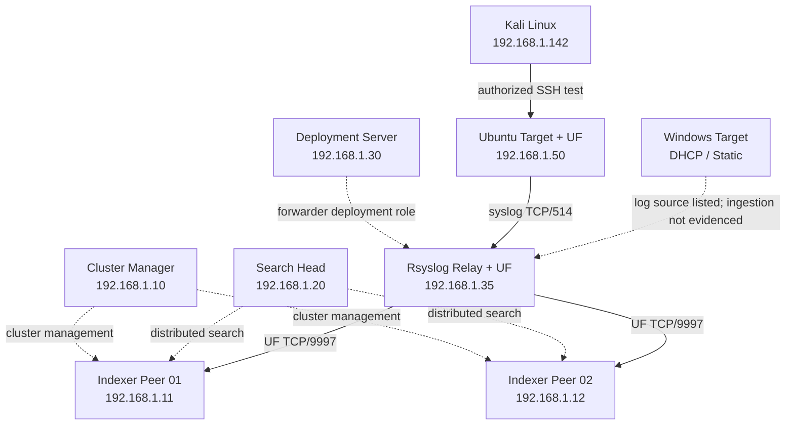

# Splunk Distributed SIEM — Implementation & Security Detection POC

**Corvit Networks | Cybersecurity Engineering Portfolio**

A hands-on **nine-system Splunk Enterprise distributed SIEM proof of concept**, covering clustered indexing, centralized syslog collection, Linux authentication telemetry, SPL-based threat detection, and SSH brute-force alert validation.

> **Scope:** This repository documents a proof of concept, not a production-certified deployment. SOAR integration is a future phase. Screenshots are implementation evidence captured from the environment; they do not independently establish availability, performance, or production security controls.

## Contents

- [Architecture](#architecture)
- [VM inventory](#vm-inventory)
- [Technology and ports](#technology-and-ports)
- [Implementation](#implementation)
- [Detection use case](#detection-use-case)
- [Evidence](#evidence)
- [Troubleshooting and lessons learned](#troubleshooting-and-lessons-learned)
- [Validation gaps and next steps](#validation-gaps-and-next-steps)

## Architecture



**Diagram notes:** The solid connections reflect the documented syslog and forwarding design; dotted connections represent management relationships or an inventory-only endpoint. The source document also specifies Ubuntu UF → `192.168.1.35:9997`, but does **not** establish a Splunk receiving service at that relay address; that path is therefore not shown as operational. No extra VM is assumed.

## VM inventory

| Hostname | Role | IP address | Operating system | Allocation |
|---|---|---|---|---|
| Splunk-Master | Cluster Manager | `192.168.1.10` | Ubuntu 20.04 | 2 vCPU / 4 GB |
| Splunk-Idx-01 | Indexer Peer | `192.168.1.11` | Ubuntu 20.04 | 2 vCPU / 4 GB |
| Splunk-Idx-02 | Indexer Peer | `192.168.1.12` | Ubuntu 20.04 | 2 vCPU / 4 GB |
| Splunk-SH-01 | Search Head | `192.168.1.20` | Ubuntu 20.04 | 2 vCPU / 4 GB |
| Splunk-DS-01 | Deployment Server | `192.168.1.30` | Ubuntu 20.04 | 1 vCPU / 2 GB |
| splunk-rsyslog01 | Rsyslog Relay + Universal Forwarder | `192.168.1.35` | Ubuntu 20.04 | 1 vCPU / 2 GB |
| Ubuntu-Target | Linux Log Source + Universal Forwarder | `192.168.1.50` | Ubuntu 20.04 | 1 vCPU / 2 GB |
| Kali-Linux | Authorized security-test workstation | `192.168.1.142` | Kali Linux | 1 vCPU / 2 GB |
| Windows-Target | Windows Log Source (inventory only) | DHCP / Static | Windows 10 | 2 vCPU / 4 GB |

## Technology and ports

| Technology | Version / role | Port / protocol |
|---|---|---|
| Splunk Enterprise | **10.0.2**, as documented | Web `8000/TCP`, management `8089/TCP` |
| Splunk indexer clustering | Cluster Manager + two peers | Replication `9887/TCP` |
| Splunk Universal Forwarder | **9.4.0** in primary installation instructions; another section references **9.2.1** | Forwarding `9997/TCP` |
| Rsyslog | Central log relay | `514/TCP`, `514/UDP` |
| OpenSSH | Authentication event source | `22/TCP` |

> The documented software versions and Ubuntu 20.04 reflect the original build, not a recommendation for new deployments. Validate current Splunk OS/UF compatibility before rebuilding or upgrading.

## Implementation

### 1. Hostname and name resolution

```bash
sudo hostnamectl set-hostname <hostname>
sudo nano /etc/hosts
# Ensure cloud-init does not reset the hostname on reboot.
```

### 2. Install Splunk Enterprise

Install the **documented 10.0.2 package** on the Cluster Manager, two indexers, Search Head, and Deployment Server. Use the official Splunk download for the correct release/build rather than copying an unverified installer URL.

```bash
sudo dpkg -i splunk.deb
sudo /opt/splunk/bin/splunk start --accept-license
sudo /opt/splunk/bin/splunk enable boot-start -user splunk
```

### 3. Configure indexer clustering

The following examples reflect the source document's clustering topology. **Replace placeholders with your own securely managed values; never commit real credentials or shared secrets.**

**Cluster Manager (`192.168.1.10`):**

```ini
# /opt/splunk/etc/system/local/server.conf
[clustering]
mode = manager
pass4SymmKey = <CLUSTER_SHARED_SECRET>
```

**Indexer peers (`192.168.1.11` and `192.168.1.12`):**

```ini
[replication_port://9887]

[clustering]
mode = peer
manager_uri = https://192.168.1.10:8089
pass4SymmKey = <CLUSTER_SHARED_SECRET>
```

**Search Head (`192.168.1.20`):**

```ini
[clustering]
mode = searchhead
manager_uri = https://192.168.1.10:8089
pass4SymmKey = <CLUSTER_SHARED_SECRET>
```

Apply correct file ownership and restart in the documented order: Cluster Manager → Indexer 01 → Indexer 02 → Search Head.

```bash
sudo chown splunk:splunk /opt/splunk/etc/system/local/server.conf
sudo /opt/splunk/bin/splunk restart
sudo /opt/splunk/bin/splunk show cluster-status -auth '<ADMIN_USER>:<ADMIN_PASSWORD>'
```

**Observed in the source screenshots:** both peers **Up**, data searchable, and replication/search factors **Met**. The source terminal output also displays **HA Mode: Disabled**; this is not evidence of a production high-availability design.

### 4. Configure the syslog relay

On `splunk-rsyslog01` (`192.168.1.35`), enable Rsyslog TCP/UDP listeners on port 514 and save incoming messages under `/var/log/remote/`.

```conf
# /etc/rsyslog.conf — relevant listener settings
module(load="imudp")
input(type="imudp" port="514")
module(load="imtcp")
input(type="imtcp" port="514")
```

```conf
# /etc/rsyslog.d/remote.conf — documented configuration
$template RemoteLogs,"/var/log/remote/%HOSTNAME%.log"
*.* ?RemoteLogs
```

```bash
sudo mkdir -p /var/log/remote
sudo chown syslog:adm /var/log/remote
sudo chmod 755 /var/log/remote
sudo ufw allow 514/udp
sudo ufw allow 514/tcp
sudo systemctl restart rsyslog
```

The relay Universal Forwarder monitors these files:

```ini
# /opt/splunkforwarder/etc/system/local/inputs.conf
[monitor:///var/log/remote/]
disabled = false
sourcetype = syslog
index = main
```

```ini
# /opt/splunkforwarder/etc/system/local/outputs.conf
[tcpout]
defaultGroup = indexer_cluster

[tcpout:indexer_cluster]
server = 192.168.1.11:9997, 192.168.1.12:9997
```

### 5. Configure the Ubuntu authentication source

The source document configures Ubuntu to forward syslog to the relay:

```bash
echo '*.* @@192.168.1.35:514' | sudo tee /etc/rsyslog.d/50-default.conf
sudo systemctl restart rsyslog
```

It also shows this **separate** Universal Forwarder input:

```ini
[monitor:///var/log/auth.log]
disabled = false
sourcetype = linux_secure
index = main
```

**Important configuration caveat:** the original Ubuntu `outputs.conf` targets `192.168.1.35:9997`. The relay is documented as an **Rsyslog listener on 514** and a **forwarder to indexers on 9997**, not a receiving Splunk instance on 9997. That UF path must be corrected or validated. If both syslog relay and direct UF collection are enabled for the same messages, check for duplicate ingestion. This repository does not silently represent that path as verified.

## Detection use case

**Scenario:** Generate authorized failed SSH authentication attempts from Kali Linux against `Ubuntu-Target` and identify repeated failures by source IP.

```spl
index=* host=ubuntu-target "Failed password"
```

```spl
index=* host=ubuntu-target "Failed password"
| rex field=_raw "from (?<src_ip>\d+\.\d+\.\d+\.\d+)"
| stats count by src_ip
| where count > 5
```

The source describes saving this search as an alert triggered when results are greater than zero. Run security testing only against systems you own or are authorized to assess.

## Evidence

These images were extracted from the supplied implementation document and are included as **original POC evidence**, not newly simulated results.

### Indexer peers online


### Searchable indexes and replication


### Search Head: ingested Ubuntu events


### SSH brute-force alert configuration


### Triggered security alerts


### Event count summary


## Troubleshooting and lessons learned

| Issue encountered | Diagnosis / documented action |
|---|---|
| Netplan YAML rejected tabs | Replaced tabs with spaces and corrected interface name to `eth0` |
| Hostname reverted after reboot | Set cloud-init `preserve_hostname: true` |
| Search Head web UI unavailable on 8000 | Checked Splunk service status, restarted, verified listening port and disk space |
| Universal Forwarder installer returned 404 | Replaced placeholder build hash with actual package filename |
| Data ingestion returned zero events | Reviewed UF outputs, syslog forwarding, test target IP, file permissions, and missing cluster peer |
| `grep` could not locate indexed data | Used Splunk search instead of searching compressed bucket files directly |
| Events landed in unexpected relay log | Reviewed source hostname/address handling in Rsyslog test messages |

**Operational caution:** The source mentions clearing the UF fishbucket as a troubleshooting step. This can cause replay/duplicate ingestion and should not be a routine production fix.

## Validation gaps and next steps

- Confirm the **end-to-end** source → relay → forwarder → indexer event path, including duplicate prevention.
- Validate **replication/search factors**, indexer peer failure recovery, and resource sizing under load.
- Confirm that the documented relay is **not incorrectly treated as a Splunk TCP receiver**.
- Implement and verify **Windows Event Log** collection; the Windows endpoint is inventoried but not evidenced in screenshots.
- Review **TLS certificates**, least-privilege access, credentials, retention, backup, and firewall controls.
- Tune SSH detection for false positives, alert suppression, and meaningful time windows.
- Explore **SOAR integration** as a future workstream; no completed SOAR playbook is claimed.

## Publication and security notes

- Configuration snippets use **placeholder secrets**. Do not upload live credentials, tokens, or production certificates.
- All IP addresses are from the documented private-address POC inventory.
- Evidence images are screenshots from the original document and may include their original application timestamps; review them before public distribution.
- This project is a technical proof of concept and should not be represented as a production deployment.

---

**Project:** Distributed Splunk SIEM | **Focus:** Security Architecture · SIEM Engineering · Log Ingestion · Threat Detection · Troubleshooting
